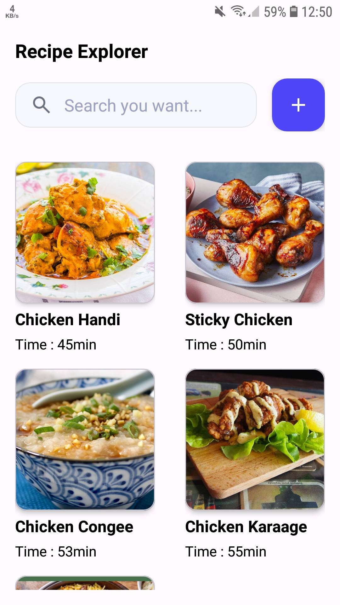
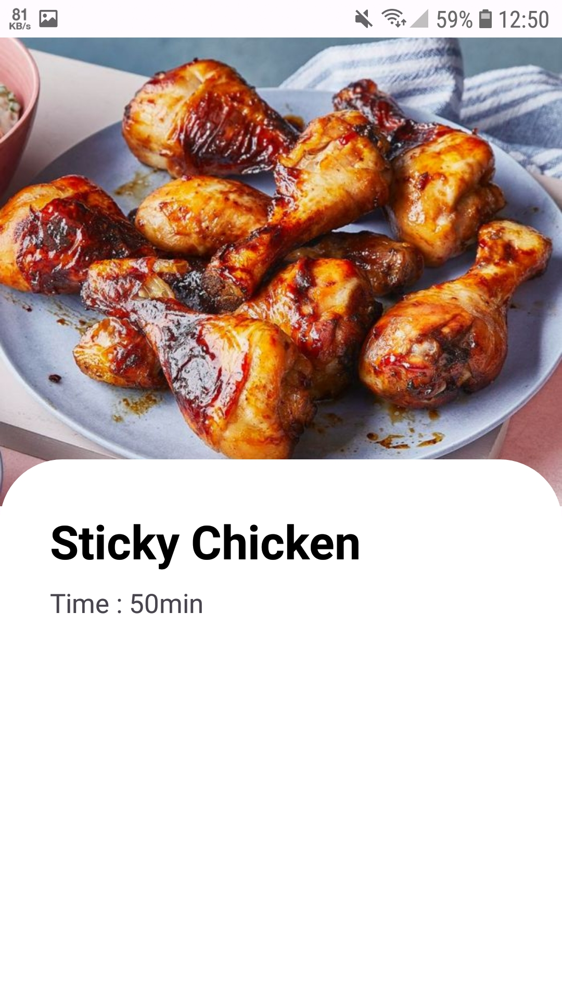

# RecipeExplorer

An Android recipe browsing app built with Kotlin and XML.

## Features

- Display recipes in a grid layout.
- Show recipe images, names, and cooking times.
- Open a separate recipe details screen.
- Pass recipe data using Intent.

## Technologies Used

- Kotlin
- XML
- RecyclerView
- ViewBinding
- Intent
- GridLayoutManager

## Data Source

Currently, the app uses local dummy data.

## Future Improvements

- Integrate TheMealDB API using Retrofit.
- Add recipe search functionality.
- Fetch recipe details from the API.

## Screenshots

### Home Screen

### Recipe Details
